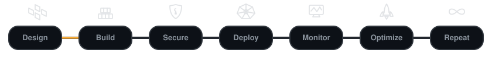
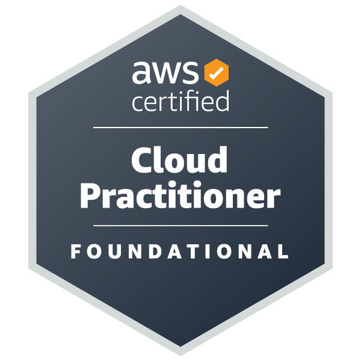
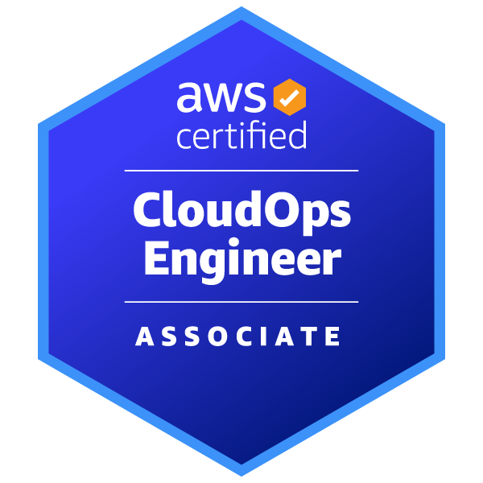
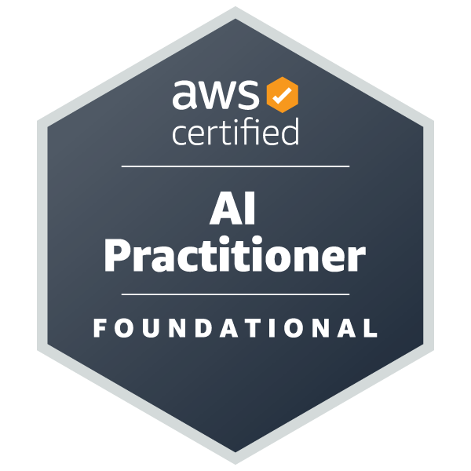

# Dai Thang — DevOps & Cloud Engineer

  

  

---

### 👋 About Me

Hello! I'm **Dai Thang**, a final-year student at **University of Information Technology – VNU-HCM (UIT)**, focused on **AWS Cloud Engineering and DevOps**.

I enjoy building practical cloud platforms with automated deployments, secure networking, and reliable monitoring. My hands-on work spans **Amazon ECS Fargate, Amazon EKS, Terraform, GitHub Actions, Jenkins, and CloudWatch**.

- ☁️ **AWS Architecture & Operations:** Designing private workloads and service-to-service networking with VPC, ALB, IAM, EC2, ECS, EKS, RDS, and S3; troubleshooting application and infrastructure issues.
- ☸️ **Containers & Kubernetes:** Building and operating containerized applications on Amazon ECS Fargate and EKS, including health checks, networking, permissions, and scaling.
- 🛡️ **DevSecOps:** Integrating Trivy and SonarQube into CI/CD, using Secrets Manager and least-privilege IAM, and keeping workloads isolated in private subnets.
- ⚙️ **Automation & Observability:** Provisioning infrastructure using Terraform, creating CI/CD workflows with GitHub Actions and Jenkins, and monitoring with CloudWatch, Prometheus, and Grafana.

My engineering philosophy:

  

---

### 🏅 AWS Certifications

  

| Badge | Certification Name | Level | Issuer | Validity | Verification |
|:---:|:---|:---:|:---:|:---:|:---:|
|  | **AWS Certified Cloud Practitioner** | Foundational | Amazon Web Services | 2026 – 2029 | [Credly ↗](https://www.credly.com/users/daithang59/badges/credly) |
|  | **AWS Certified Solutions Architect – Associate** | Associate | Amazon Web Services | 2026 – 2029 | [Credly ↗](https://www.credly.com/users/daithang59/badges/credly) |
|  | **AWS Certified CloudOps Engineer – Associate** | Associate | Amazon Web Services | 2026 – 2029 | [Credly ↗](https://www.credly.com/users/daithang59/badges/credly) |
|  | **AWS Certified Developer – Associate** | Associate | Amazon Web Services | 2026 – 2029 | [Credly ↗](https://www.credly.com/users/daithang59/badges/credly) |
|  | **AWS Certified AI Practitioner** | Foundational | Amazon Web Services | 2026 – 2029 | [Credly ↗](https://www.credly.com/users/daithang59/badges/credly) |

---

### 🛡️ DevSecOps & Cloud Security Practices

- **🔒 Cloud Infrastructure Security (AWS)**
  - **Compute & Orchestration:** Secure workloads on EC2, Amazon ECS (Fargate), and Amazon EKS with network isolation and security groups.
  - **Least Privilege:** IAM roles, ECS task roles, and IAM Roles for Service Accounts (IRSA) in Kubernetes.
  - **Networking:** Private subnets, NAT gateways, ALB target groups, VPC routing, and AWS security group rules.
- **🚀 Automated Secure Pipelines (CI/CD)**
  - **Delivery:** GitHub Actions and Jenkins workflows from container build to Amazon ECR and service deployment.
  - **Code & Image Security:** Trivy vulnerability scanning and SonarQube quality checks in pipelines.
- **🔑 Secrets Management**
  - Using AWS Secrets Manager to avoid hardcoded credentials and control runtime access with IAM.
- **📊 Observability & Operations**
  - CloudWatch metrics, logs, alarms, health checks, Prometheus, and Grafana for operational visibility.

---

### 🛠️ Tech Stack & Tooling

  

---

### 🌐 Connect with Me

  
  &nbsp;
  
  &nbsp;
  

---

  

Design / animation credits: [Kien-devops](https://github.com/Kien-devops/Kien-devops). Original SVG source reused with permission (please confirm with author before publishing).
