# Dai Thang — AWS Cloud & DevOps Engineer

  

  

  
  
  

---

### 👋 About Me

Hello! I'm **Dai Thang**, a final-year student at **University of Information Technology – VNU-HCM (UIT)**, focused on a career in **AWS Cloud Engineering and DevOps**.

I enjoy turning cloud architecture diagrams into secure, automated, and observable systems through hands-on projects.

- ☁️ **Cloud Architecture & Operations:** AWS VPC, IAM, ALB, EC2, ECS Fargate, EKS, RDS, S3, CloudFront, CloudWatch.
- ⚙️ **Infrastructure as Code & CI/CD:** Terraform, GitHub Actions, Jenkins, Docker, ECR.
- 🛡️ **DevSecOps:** Least-privilege IAM, IRSA, AWS Secrets Manager, Trivy, SonarQube.
- 📊 **Observability & Troubleshooting:** CloudWatch, Prometheus, Grafana, health checks, incident investigation.

My engineering philosophy:

  

---

### 🏅 AWS Certifications

  

<strong>03 Associate · 02 Foundational · 05 AWS Certifications</strong>

| Badge | Certification | Level | Issuer | Verification |
|:---:|:---|:---:|:---:|:---:|
|  | **AWS Certified Solutions Architect – Associate** | Associate | AWS | [Credly ↗](https://www.credly.com/users/daithang59/badges/credly) |
|  | **AWS Certified CloudOps Engineer – Associate** | Associate | AWS | [Credly ↗](https://www.credly.com/users/daithang59/badges/credly) |
|  | **AWS Certified Developer – Associate** | Associate | AWS | [Credly ↗](https://www.credly.com/users/daithang59/badges/credly) |
|  | **AWS Certified AI Practitioner** | Foundational | AWS | [Credly ↗](https://www.credly.com/users/daithang59/badges/credly) |
|  | **AWS Certified Cloud Practitioner** | Foundational | AWS | [Credly ↗](https://www.credly.com/users/daithang59/badges/credly) |

---

### 🛡️ Cloud Engineering & DevSecOps

- **AWS Networking & Compute:** Public/private subnet separation, security groups, load balancers, container networking, EKS/ECS, and RDS.
- **Secure Delivery:** Automated container build/deploy pipelines with GitHub Actions/Jenkins, Trivy scans, and SonarQube quality gates.
- **Secrets & Identity:** IAM least privilege, task roles, IRSA, AWS Secrets Manager, and encryption.
- **Observability:** CloudWatch logs, metrics and alarms, Prometheus, Grafana, and troubleshooting.

---

### 🛠️ Tech Stack & Tooling

  

---

### 🚀 Hands-on Projects

- **Amazon ECS Fargate Microservices / LMS:** ALB, private ECS tasks, ECR, GitHub Actions, Terraform, CloudWatch, Secrets Manager and PostgreSQL.
- **DocFlow on Amazon EKS:** Microservices, Jenkins, IRSA, CloudWatch, Prometheus/Grafana and Amazon RDS PostgreSQL.
- **Cloud-Native DevSecOps:** Secure CI/CD, container scanning, secrets management, and infrastructure automation.

See my repositories at **[github.com/daithang59](https://github.com/daithang59?tab=repositories)**.

---

### 🌐 Connect with Me

  
  
  

Original animation reference and attribution: [Nguyễn Trung Kiên's GitHub profile](https://github.com/Kien-devops/Kien-devops). Confirm reuse permission before publishing adapted files.
