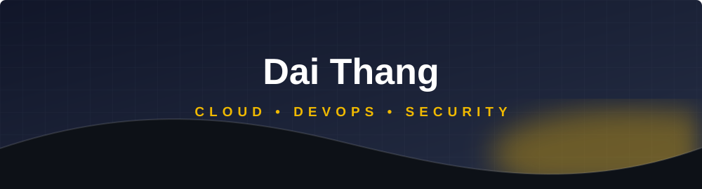
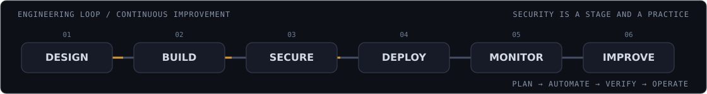

  

  

  
  
  
  

---

### About

I'm **Dai Thang**, a final-year student at the **University of Information Technology – VNU-HCM (UIT)**, building toward a career in **Cloud Engineering and DevOps**.

I focus on turning AWS architecture into working infrastructure: provisioning resources with **Terraform**, deploying containers using **ECS Fargate and EKS**, building CI/CD pipelines, and improving security and observability through hands-on projects.

- **AWS Infrastructure:** VPC, IAM, ALB, EC2, ECS, EKS, RDS, S3, CloudFront.
- **CI/CD & IaC:** GitHub Actions, Jenkins, Docker, ECR, Terraform.
- **Security:** least privilege IAM, Secrets Manager, IRSA, Trivy, SonarQube.
- **Operations:** CloudWatch, health checks, Prometheus, Grafana, troubleshooting.

### Engineering Workflow

---

### AWS Certifications

03 ASSOCIATE &nbsp;·&nbsp; 02 FOUNDATIONAL &nbsp;·&nbsp; 05 ACTIVE CERTIFICATIONS

<table align="center">
 <tr>
  <td align="center" width="20%"></td>
  <td align="center" width="20%"></td>
  <td align="center" width="20%"></td>
  <td align="center" width="20%"></td>
  <td align="center" width="20%"></td>
 </tr>
 <tr>
  <td align="center"><b>Solutions Architect Associate</b></td>
  <td align="center"><b>CloudOps Engineer Associate</b></td>
  <td align="center"><b>Developer Associate</b></td>
  <td align="center"><b>AI Practitioner</b></td>
  <td align="center"><b>Cloud Practitioner</b></td>
 </tr>
</table>

| Badge | Certification | Level | Exam | Verification |
|:---:|:---|:---:|:---:|:---:|
|  | **AWS Certified Solutions Architect – Associate** | Associate | `SAA-C03` | [Credly profile ↗](https://www.credly.com/users/daithang59/badges/credly) |
|  | **AWS Certified CloudOps Engineer – Associate** | Associate | `SOA-C03` | [Credly profile ↗](https://www.credly.com/users/daithang59/badges/credly) |
|  | **AWS Certified Developer – Associate** | Associate | `DVA-C02` | [Credly profile ↗](https://www.credly.com/users/daithang59/badges/credly) |
|  | **AWS Certified AI Practitioner** | Foundational | `AIF-C01` | [Credly profile ↗](https://www.credly.com/users/daithang59/badges/credly) |
|  | **AWS Certified Cloud Practitioner** | Foundational | `CLF-C02` | [Credly profile ↗](https://www.credly.com/users/daithang59/badges/credly) |

The verification links currently point to my public Credly profile. Individual badge URLs can replace them when available.

---

### Tooling

**Cloud & Infrastructure**

**Delivery & Quality**

**Monitoring & Data**

Other tools I use: Amazon ECR, Secrets Manager, CloudWatch, Trivy, SonarQube.

---

### Selected Projects

| Project | What I worked on | Stack |
|:---|:---|:---|
| [**EKS Cilium / kube-proxy Benchmark**](https://github.com/daithang59/NT531_EKS-Cilium-Kubeproxy-Benchmark) | Kubernetes networking benchmarks and observability | EKS, Cilium, Terraform, Prometheus |
| [**SageLMS**](https://github.com/daithang59/sagelms) | Microservices delivery and secure CI/CD | Docker, GitHub Actions, Trivy |
| [**DocVault**](https://github.com/daithang59/docvault) | Secure document workflows | PostgreSQL, Keycloak, MinIO |

Projects above are retained from the previous README draft; review names and URLs before publishing.

---

### Connect

  
  
  

